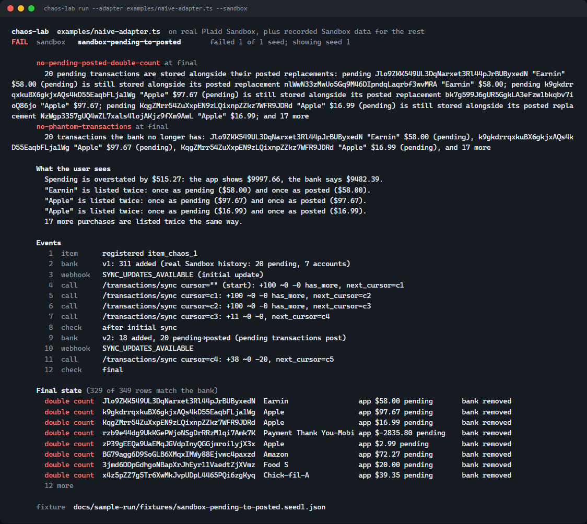

# Plaid Integration Chaos Lab

I started this after connecting my accounts through Plaid in Muse and ChatGPT. I was curious about the failure cases that show up later like a pending charge becomes posted, a webhook is delivered twice, or transaction data changes while an app is syncing

Chaos Lab tests an app’s Plaid integration against those cases. It compares the app’s stored state with a known source of truth, then reports the user impact, the events that caused it, and a fixture that reproduces the failure.



A run against real Plaid Sandbox. The app ignores `removed` from `/transactions/sync`, so when Sandbox posted 20 pending transactions it kept both copies and overstated spending by $515.27. [Full report](docs/sample-run/report.md).

## Run it

```
npm install
npm test                # tests the lab itself (41 tests, offline, no keys)
npm run demo:robust     # every scenario on the fake Plaid, 25 seeds each; expect all to pass
npm run demo:sandbox    # a deliberately buggy app on real Plaid Sandbox; expect failures and a report (needs keys in .env)
```

## What it catches

| Scenario | Bug |
|---|---|
| `pending-to-posted`\* | Ignoring `removed`, so pending and posted copies are both shown |
| `duplicate-webhook-delivery`\* | Concurrent handlers that append instead of upsert |
| `out-of-order-item-events`\* | Item health taken from webhook arrival order instead of `/item/get` |
| `paginated-sync`\* | Reading only the first page |
| `mutation-during-pagination` | Not restarting from the original cursor on `TRANSACTIONS_SYNC_MUTATION_DURING_PAGINATION` |
| `login-required-then-repaired` | Wiping data during `ITEM_LOGIN_REQUIRED`; ignoring `LOGIN_REPAIRED` |
| `missed-webhook-reconcile`\* | No scheduled catch-up sync |

\* Also runs on real Plaid Sandbox.

## How it works

- A fake Plaid ([src/fake-plaid/bank.ts](src/fake-plaid/bank.ts)) implements `/transactions/sync` (cursors, pagination, mutation errors) and `/item/get`, and holds the ground truth. Invariants such as `no-pending-posted-double-count` compare the app's state against it.
- Scenarios are seeded, so a failure replays exactly, offline, as a CI regression test.
- `--sandbox` runs the scenarios Sandbox can reproduce against real Plaid Sandbox, with ground truth from an independent sync drain plus `/item/get`. The rest run on transactions recorded from Sandbox. Every Sandbox failure is saved as an offline replay.
- Why not Sandbox alone: it can't trigger mid-pagination changes or login repair on demand, a scenario takes 30–100 s instead of milliseconds, and its timing varies between runs.

A reference app with eight switchable bugs ([examples/reference-app.ts](examples/reference-app.ts)) is used to show that each scenario catches its bug and that the corrected app passes.

## Plaid Sandbox behavior found while building this

- `/transactions/refresh` sent right after an Item's historical pull is ignored; a second one posts the pending transactions.
- `HISTORICAL_UPDATE_COMPLETE` can be reported before the transactions are visible to `/transactions/sync`.
- `/sandbox/item/fire_webhook` needs a public webhook URL on the Item, and rejects `LOGIN_REPAIRED` while the Item is in `ITEM_LOGIN_REQUIRED`.
- `/transactions/sync` occasionally returns a transient `INTERNAL_SERVER_ERROR`.

## Testing your own app

In-process (JS/TS): export a factory that builds your integration around the Plaid client the lab provides.

```ts
export default ({ plaid }) => ({
  registerItem: ({ itemId, accessToken }) => app.saveItem(itemId, accessToken),
  handleWebhook: (body) => app.onPlaidWebhook(body),
  getState: async (itemId) => ({ transactions: await app.list(itemId), itemStatus: await app.status(itemId) }),
  reconcile: (itemId) => app.scheduledSync(itemId), // optional
});
```

```
node bin/chaos-lab.js run --adapter my-adapter.ts [--sandbox]
```

Any language: point your Plaid base URL at the lab's fake API and expose a webhook endpoint plus small control endpoints. See [examples/http-app.ts](examples/http-app.ts), tested with the official `plaid` Node SDK.

